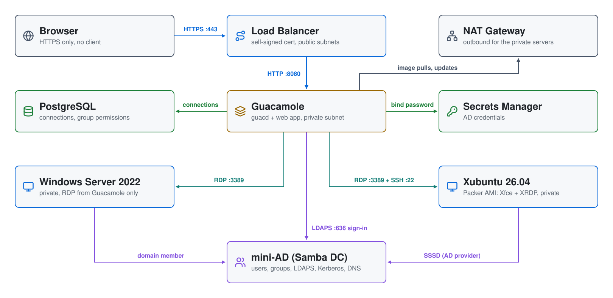

# Apache Guacamole + Active Directory on AWS

A browser-only gateway into a **private** Windows and Linux environment.
**Apache Guacamole** sits behind an Application Load Balancer. Users sign in
with their Active Directory account, then open an RDP session to a Windows
host or an SSH session to a Linux host, all in the browser and all as
themselves. No server has a public IP, and there's no VPN or SSH key to hand
out.

| Piece | Where | Role |
|---|---|---|
| **ALB** | public subnets (2 AZs) | HTTPS with a self-signed certificate; HTTP redirects to HTTPS. The only internet-facing piece. |
| **Guacamole** | private subnet | guacd + the Guacamole web app + PostgreSQL, in Docker |
| **Windows Server 2022** | private subnet | joined to AD; RDP from Guacamole only |
| **Ubuntu 24.04** | private subnet | joined to AD with SSSD (AD provider); SSH from Guacamole only |
| **mini-AD** (Samba DC) | private subnet | users, groups, DNS, Kerberos, LDAPS |
| **NAT gateway** | public subnet | outbound internet for the private servers |

## Architecture

<picture>
  <source media="(prefers-color-scheme: dark)" srcset="architecture-dark.svg">
  
</picture>

Regenerate with `python3 make_diagram.py`.

- **`01-directory/`**: the VPC (two public subnets, a private server
  subnet, the DC's subnet), the NAT gateway, and the
  [`module-aws-mini-ad`](https://github.com/mamonaco1973/module-aws-mini-ad)
  Samba DC with users and POSIX attributes from `users.json`. DHCP points VPC
  DNS at the DC.
- **`02-servers/`**: the ALB and its certificate, the Guacamole server, the
  Linux and Windows hosts, and their security groups.

## How sign-in works

1. The user browses to the ALB and signs in to Guacamole as an AD user
   (`jsmith`). Guacamole checks the password against AD over **LDAPS**. Only
   members of **`mcloud-users`** are allowed in.
2. Guacamole's PostgreSQL database holds two connections, **Windows (RDP)**
   and **Linux (SSH)**. They're granted to a database group named
   `mcloud-users`, and Guacamole applies that group to anyone who belongs to
   the AD group of the same name.
3. Both connections use Guacamole's `${GUAC_USERNAME}` / `${GUAC_PASSWORD}`
   tokens, so each session logs in to the target **as the signed-in user,
   with their AD password**. One sign-in reaches both machines.
4. Members of **`linux-admins`** (jsmith) also get Guacamole's administer
   right, so they can add connections in the UI. The built-in
   `guacadmin`/`guacadmin` account is disabled.

For LDAPS, Guacamole must trust the DC's certificate. The Samba DC creates
its own CA and serves it at `http://ad1.<domain>/ca.pem`. The Guacamole
server fetches it at boot and puts it in a Java trust store for the web app.

## Security groups

```
internet ─443/80─▶ ALB ─8080─▶ Guacamole ─3389─▶ Windows
                                         └──22──▶ Linux
```

`allowed_cidrs` (in `02-servers/variables.tf`) controls who can reach the
ALB. It defaults to `0.0.0.0/0`; every login still needs an AD account in
`mcloud-users`. To limit it to your own address:

```bash
export TF_VAR_allowed_cidrs='["203.0.113.7/32"]'
./apply.sh
```

Admin access to the private servers is **SSM Session Manager**: all three
have the SSM instance role, and no public SSH or RDP exists.

## Prerequisites

* [An AWS Account](https://aws.amazon.com/console/)
* [Install AWS CLI](https://docs.aws.amazon.com/cli/latest/userguide/getting-started-install.html)
* [Install Terraform](https://developer.hashicorp.com/terraform/install)
* [Install jq](https://jqlang.github.io/jq/download/) and `curl`

## Deploy

```bash
./apply.sh       # phase 1: VPC + mini-AD, phase 2: ALB, Guacamole, Windows, Linux
./validate.sh    # waits for Guacamole, signs in as jsmith, prints the URL
```

`validate.sh` signs in to Guacamole's API as `jsmith` and checks that both
connections are granted. That exercises LDAPS, the group gate and the
database permissions. It ends with:

```
Guacamole + Active Directory
============================
URL      : https://guacamole-alb-123456789.us-east-1.elb.amazonaws.com/
           Self-signed certificate: the browser warns once;
           choose Advanced > Proceed.
Sign in  : jsmith / orange-481920
Connect  : Windows (RDP) and Linux (SSH), as the signed-in user.
```

The Windows host needs about **10 minutes** after deploy to join the domain
and reboot before RDP accepts domain logins.

## Try it

1. Open the URL, accept the certificate warning, and sign in as `jsmith`.
2. Click **Linux (SSH)**: a terminal opens, logged in as `jsmith`. Try
   `id`, `getent group linux-admins`, and `sudo -l` (linux-admins have
   passwordless sudo).
3. Go back (Ctrl+Alt+Shift opens the Guacamole menu) and click **Windows
   (RDP)**: a desktop opens as `MCLOUD\jsmith`. **Active Directory Users and
   Computers** is installed.
4. Sign out and sign in as `rpatel`: the same two connections, as rpatel.
   Not in `linux-admins`, so there's no admin menu and no sudo.

User passwords are in Secrets Manager as `<user>_ad_credentials_efs`:

```bash
aws secretsmanager get-secret-value --secret-id rpatel_ad_credentials_efs \
  --query SecretString --output text | jq -r .password
```

## Troubleshooting

| Symptom | Fix |
|---|---|
| `validate.sh`: target not healthy | Guacamole's setup is still running or failed. `aws ssm start-session --target <guacamole_instance_id>`, then `sudo cat /root/userdata.log`. |
| Sign-in fails for everyone | LDAPS: on the Guacamole server, `cd /opt/guacamole && sudo docker compose logs guacamole`. Check `/opt/guacamole/tls/ca.pem` was fetched from the DC. |
| One user can't sign in | They must be in AD group `mcloud-users`. |
| Windows (RDP) disconnects at once | The host is still joining the domain and rebooting (about 10 minutes after deploy). |
| Linux (SSH) rejects the password | The host hasn't finished its domain join; check `/root/userdata.log` over SSM. |
| Browser certificate warning | Expected: the certificate is self-signed. Import a real ACM certificate and point a DNS name at the ALB to remove it. |

## Teardown

```bash
./destroy.sh     # destroys phase 2, deletes the demo secrets, destroys phase 1
```

## Notes

- **Lab only.** The certificate is self-signed, the ALB is open by default,
  and Guacamole binds to LDAP with the domain admin account (its password
  is in the server's `/opt/guacamole/.env`, readable only by root). Use a
  dedicated read-only bind account and a real certificate for anything
  more.
- Users, groups and POSIX IDs are defined in
  `01-directory/scripts/users.json.template`.
